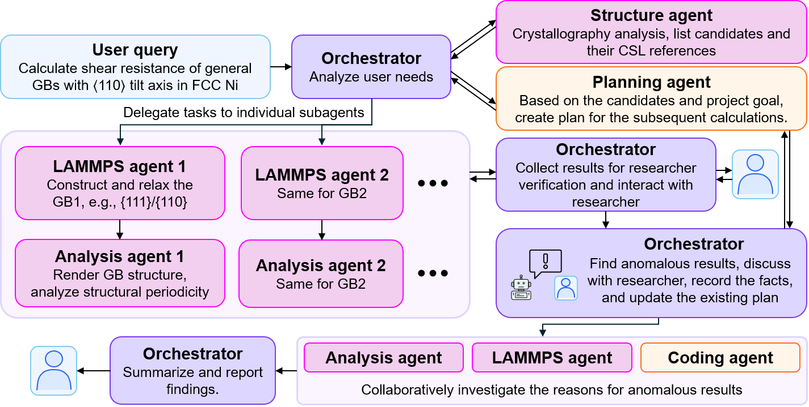

<h1 align="center">
  <picture>
    <source media="(prefers-color-scheme: dark)" srcset="docs/assets/GBClaw-logo-light.svg">
    <source media="(prefers-color-scheme: light)" srcset="docs/assets/GBClaw-logo.svg">
    
  </picture>
</h1>

<p align="center"><strong>From grain boundary questions to traceable atomistic investigations.</strong></p>

<p align="center">
  <a href="#framework-manuscript">Manuscript</a> ·
  <a href="#quick-start">Quick start</a> ·
  <a href="#architecture">Architecture</a> ·
  <a href="#research-workflow">Research workflow</a> ·
  <a href="#documentation">Documentation / 中文</a> ·
  <a href="#license-and-disclaimer">License</a>
</p>

<a id="framework-manuscript"></a>

If you use this architecture in your work, or find it helpful, please cite:

> Y. Liu, K. Ding, X. Gong, Z. Wang, Y. Yang, Y. Che, W. Chen, J. Kacher, O. Pierron, S. Ogata, T. Zhu, **GBClaw: An agentic AI framework for atomistic grain boundary research and mechanistic discovery**, arXiv preprint arXiv:2610.28629 (2026). https://doi.org/10.48550/arXiv.2610.28629.

For a deeper discussion of the scientific questions behind GBClaw, we invite you to read our related study: 

>K. Ding, Y. Liu, Y. Zhang, L. Wang, X. Han, T. Zhu, **Misfit-dislocation hierarchy governs sliding of asymmetric non-CSL grain boundaries**, arXiv preprint arXiv:2609.14673 (2026). https://doi.org/10.48550/arXiv.2609.14673.

**Status.** The manuscript describes GBClaw **v1.0** ([tag `v1.0`](https://github.com/ZhuGroup-GT/GBClaw/releases/tag/v1.0)); check out that tag to reproduce it. The project is under active development: later versions may change the project storage format, configuration keys, tool contracts and the HTTP API without backward compatibility, so a project created by one version may not open in another. GBClaw runs on Linux only.

## Overview

GBClaw is a researcher-guided AI framework for atomistic grain boundary (GB) research. Describe a scientific question in natural language, inspect the proposed approach, and work with specialist agents to screen crystallography, build and relax bicrystals, study deformation, and investigate the mechanisms behind unexpected results.

The framework connects domain tools, LAMMPS simulations, OVITO analysis, and custom Python scripts in one persistent project. Calculations produce identifiable runs and reusable artifacts, so a follow-up question can return to the structures, curves, and assumptions behind an earlier conclusion. Researchers guide the objectives, review evidence, and decide where to investigate next.

## Architecture

One **orchestrator** talks to the researcher and coordinates **five specialist agents**, built on LangChain and LangGraph. Specialists receive a focused task and references to relevant evidence; they return findings and output references. Independent cases can run concurrently within configured resource budgets (Structure and LAMMPS work is serialized by default; set `GBCLAW_SERIAL_EXECUTION=0` in `.env` to allow it).


*Figure 1 from the GBClaw manuscript. The diagram presents the overall design; this repository implements long-term records in SQLite with artifact files and Markdown views. Backend availability depends on installed runtimes; the planning agent has no built-in web search, but the orchestrator can use an optional `search_web` tool configured in `.key`.*

| Agent | Responsibility |
| --- | --- |
| **Planning** | Turn research objectives into methods, dependencies, validation checks, and a plan for approval. |
| **Structure** | Analyze crystallography, CSL and near-CSL relationships, GB planes, and orientations. |
| **LAMMPS** | Build bicrystals, relax structures, calculate GB energies, and run shear and NEB workflows. |
| **Analysis** | Interpret stress–strain curves, structural periodicity and transition pathways; render atomic structures. |
| **Coding** | Write and validate small custom scripts, transformations, and analyses beyond the standard tools. |

Standard scientific workflows keep their domain checks and provenance rules. The coding agent adds flexibility through a disposable sandbox with selected input artifacts and registered Python environments. ASE is available through this route once its optional environment is installed. See [agent execution](docs/agent-runtime.md) and [coding environments](docs/coding-agent.md).

## Why the system is organized this way

**Research changes direction.** Plans are reviewable drafts. After approval, execution tracks dependencies, progress, and outputs; a revised plan preserves the work already performed. The researcher can move from screening many boundaries to investigating one anomalous result.

**Context should stay focused as a project grows.** Each specialist receives the information needed for its task and retrieves additional evidence on demand. Project memory separates different purposes instead of continually expanding the prompt:

| Layer | What it provides |
| --- | --- |
| Domain knowledge | Scientific methods, tool contracts, and workflow guidance. |
| Project summary | Current goals, important findings, unresolved questions, and retrieval pointers. |
| Recent conversation and session summary | Enough continuity to follow the current discussion. |
| Persistent research records | Searchable facts, runs, conclusions, and artifact references in SQLite. |
| Scientific artifacts | Structures, trajectories, logs, scripts, figures, and detailed analysis outputs. |

**A summary is a map to evidence.** The project summary is deliberately selective. When it is condensed, previous versions remain in the database; archive IDs and short topic previews tell agents where to recover omitted context. Detailed records and artifacts remain available through memory tools. The complete chat archive is retained separately for human review. Selected conversation-derived claims retain their origin and remain distinguishable from tool results.

**Traceability supports scientific judgment.** A conclusion drawn from a calculation can be traced to its source run and outputs. That link makes review possible; physical interpretation still requires the researcher's judgment. The [memory guide](docs/project-memory.md) explains these boundaries.

See [Architecture and design](docs/architecture.md) for the reasoning behind these choices, a worked investigation, and the responsibilities of each layer.

## Research workflow

The accompanying manuscript demonstrates the framework on **14 general asymmetric tilt GB configurations in nickel**, connecting broad screening with targeted investigation of anomalous sliding resistance and metastable boundary structures.



*Figure 2 from the manuscript: researcher review and replanning connect screening to mechanism discovery.*

A project can develop through requests such as:

1. **Plan:** “Plan a study of shear resistance in general asymmetric ⟨110⟩ tilt boundaries in FCC nickel. Identify candidate boundaries and the inputs needed before running calculations.”
2. **Review and execute:** Inspect or revise the draft, choose the potential and simulation settings, then approve execution. Review the resulting structures and stress–strain curves.
3. **Investigate:** “Compare these completed runs. For the unusually resistant boundary, propose a follow-up study of the structural transition and an NEB calculation.”

Use `/plan <request>` to explicitly request a plan, or ask a bounded question directly. The same project retains its results for later sessions. See the [workflow catalog](docs/tools.md) for supported calculations and required inputs.

## Quick start

GBClaw runs on Linux (x86-64) only: project ownership relies on `fcntl` file locks, the coding sandbox needs Bubblewrap and `prlimit`, subprocess control uses process groups, and `conda_env.yml` is a linux-64 snapshot. macOS and Windows are not supported, and WSL2 is untested. You also need Conda and credentials for a supported LLM endpoint.

```bash
git clone https://github.com/ZhuGroup-GT/GBClaw.git
cd GBClaw
conda env create -f conda_env.yml
cp .key.example .key
cp .env.example .env
```

Edit `.key` with your provider, model, and credentials in `[default]`. Use `.env` for runtime resources and environment names. Then start the Web UI:

```bash
./start_web.sh
```

Open **http://127.0.0.1:9999/**, create or select a project, and send a research request. For a terminal session, run `./start_cli.sh` instead. Both launchers activate the `GBclaw` Conda environment and use the same project storage.

Install the additional runtimes needed for your work:

| Runtime | Purpose |
| --- | --- |
| `GBclaw` | Application, agent orchestration, and analysis; the environment file includes OVITO. |
| `GBclaw-lammps` | LAMMPS Python bindings, compatible MPI, and the pair styles required by the selected potentials. Configurable with `GBCLAW_LAMMPS_CONDA_ENV`. |
| `GBclaw-ase` (optional) | Atomic Simulation Environment for custom coding tasks. Configurable with `GBCLAW_ASE_CONDA_ENV`. |

Coding tasks also require Linux Bubblewrap and `prlimit`. For ASE, the default configuration is `GBCLAW_ASE_CONDA_ENV=GBclaw-ase`; after that environment and ASE are installed, the orchestrator can select the registered `ase` runtime. An uninstalled environment is reported as unavailable and does not block application startup.

See [Getting started](docs/getting-started.md) for the quick LAMMPS installation using prebuilt packages, optional source builds, ASE setup, and launch options; see [Configuration](docs/configuration.md) for model routing, potentials, and resource limits.

## Documentation

Start with the [documentation guide](docs/README.md) ([中文文档](docs/zh/README.md)) for a reading path matched to your task. Each technical guide explains its design choices before the implementation details.

| Topic | English | 中文 |
| --- | --- | --- |
| Architecture and design decisions | [Architecture and design](docs/architecture.md) | [架构与设计逻辑](docs/zh/architecture.md) |
| Installation, launchers, and CLI | [Getting started](docs/getting-started.md) | [快速上手](docs/zh/getting-started.md) |
| Agent coordination and planning | [Agent runtime](docs/agent-runtime.md) | [智能体运行时](docs/zh/agent-runtime.md) |
| Research records, summaries, and retrieval | [Project memory](docs/project-memory.md) | [项目记忆](docs/zh/project-memory.md) |
| Scientific tools and workflows | [Tools](docs/tools.md) | [工具与工作流](docs/zh/tools.md) |
| Models, environments, and resources | [Configuration](docs/configuration.md) | [配置](docs/zh/configuration.md) |
| Custom scripts and ASE runtimes | [Coding agent](docs/coding-agent.md) | [Coding agent](docs/zh/coding-agent.md) |
| Interactive lattice exploration | [Dichromatic map](docs/dichromatic-map.md) | [双色点阵图](docs/zh/dichromatic-map.md) |
| Web interface and API | [API and UI](docs/api-and-ui.md) | [API 与界面](docs/zh/api-and-ui.md) |
| Adding agents, tools and other extensions | [Extension guide](docs/extension-guide.md) | [扩展开发指南](docs/zh/extension-guide.md) |
| Source layout and ownership | [Code map](docs/src-code-map.md) | [源码地图](docs/zh/src-code-map.md) |

## Acknowledgments

The architecture and research workflow figures above are extracted from the [framework manuscript](#framework-manuscript). See [figure sources](docs/assets/README.md) and [references and acknowledgments](docs/references.md) for the full author list, related agent frameworks, scientific software, and potential citations.

## License and disclaimer

GBClaw is released under the [MIT License](LICENSE).

**Disclaimer.** GBClaw is research software provided “as is”, without warranty of any kind, as the license states. It drives large language models and atomistic simulations on your machine: model output can be wrong or incomplete, simulations and the coding sandbox can consume substantial CPU time, memory and disk, and generated code runs on your hardware inside a Bubblewrap sandbox. Every result needs the researcher's own validation before it is relied on or published; the authors and contributors accept no liability for decisions, publications or damage arising from the software or its output. Project content, including prompts, chat history and tool results, is sent to the configured LLM provider under that provider's terms. Third-party software reached through GBClaw, such as LAMMPS, OVITO, MPI, interatomic potentials and LLM services, is governed by its own license; [references and acknowledgments](docs/references.md) lists the software and potentials used.
