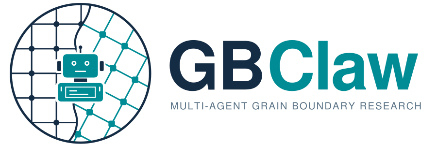

  <picture>
    <source media="(prefers-color-scheme: dark)" srcset="assets/GBClaw-logo-light.svg">
    <source media="(prefers-color-scheme: light)" srcset="assets/GBClaw-logo.svg">
    
  </picture>

# GBClaw documentation

[Project overview](../README.md) · [中文文档](zh/README.md)

GBClaw coordinates atomistic grain boundary investigations through specialist agents, scientific tools, and persistent project records. These guides explain how to use the system, why its responsibilities are separated, and where to make an extension.

## Choose a reading path

| Your goal | Start here | Continue with |
| --- | --- | --- |
| Run a first investigation | [Getting started](getting-started.md) | [Scientific tools](tools.md) and [interactive lattice selection](dichromatic-map.md). |
| Understand the architecture | [Architecture and design](architecture.md) | [Agent runtime](agent-runtime.md) and [project memory](project-memory.md). |
| Configure models and compute resources | [Configuration](configuration.md) | [Coding environments](coding-agent.md) and [API/UI operation](api-and-ui.md). |
| Add an agent or scientific tool | [Extension guide](extension-guide.md) | [Source map](src-code-map.md) and the relevant [tool workflow](tools.md). |
| Recover or inspect an earlier result | [Project memory](project-memory.md) | [Project files and APIs](api-and-ui.md). |

## Guide index

| Guide | What it answers | 中文 |
| --- | --- | --- |
| [Getting started](getting-started.md) | What do I install, configure, and run? | [快速上手](zh/getting-started.md) |
| [Architecture and design](architecture.md) | Why use specialists, hierarchical memory, and researcher review? | [架构与设计逻辑](zh/architecture.md) |
| [Agent runtime](agent-runtime.md) | How does a request become delegated work and a final answer? | [智能体运行时](zh/agent-runtime.md) |
| [Scientific tools](tools.md) | Which workflow should I use, and what inputs and outputs matter? | [工具与工作流](zh/tools.md) |
| [Project memory](project-memory.md) | What is retained, what enters model context, and how is evidence recovered? | [项目记忆](zh/project-memory.md) |
| [Extension guide](extension-guide.md) | How do I add agents, tools, orchestrator tools, routes or model providers, and check them? | [扩展开发指南](zh/extension-guide.md) |
| [Configuration](configuration.md) | Where do model settings, environment names, and budgets belong? | [配置](zh/configuration.md) |
| [Coding agent](coding-agent.md) | How do custom scripts use registered environments and publish results? | [Coding agent](zh/coding-agent.md) |
| [Dichromatic map](dichromatic-map.md) | How does a visual lattice choice become a numerical cell selection? | [双色点阵图](zh/dichromatic-map.md) |
| [API and UI](api-and-ui.md) | How do clients, execution ownership, streaming, and project files fit together? | [API 与界面](zh/api-and-ui.md) |
| [Source map](src-code-map.md) | Which package owns the code I need to change? | [源码地图](zh/src-code-map.md) |
| [Roadmap](roadmap.md) | Which extension directions and design constraints are worth exploring? | [后续设计](zh/roadmap.md) |

The [framework manuscript and related scientific study](references.md) explain the broader research motivation. [Figure sources](assets/README.md) identify the illustrations used in these guides.

## Reading and maintaining these guides

Start with a guide's purpose and design rationale, then use its reference sections when you need exact tool names, API fields, or defaults. Implementation details describe the current repository. The manuscript provides the scientific and architectural motivation; an integration shown in a conceptual diagram may still require optional software or an extension.

English and Chinese guides should describe the same behavior. Keep ordinary Markdown paragraphs on one source line and let GitHub or the editor handle visual wrapping. Preserve meaningful structure in code blocks, tables, lists, and intentional line breaks. Use relative links for repository files and link detailed contracts from the overview instead of duplicating them.

