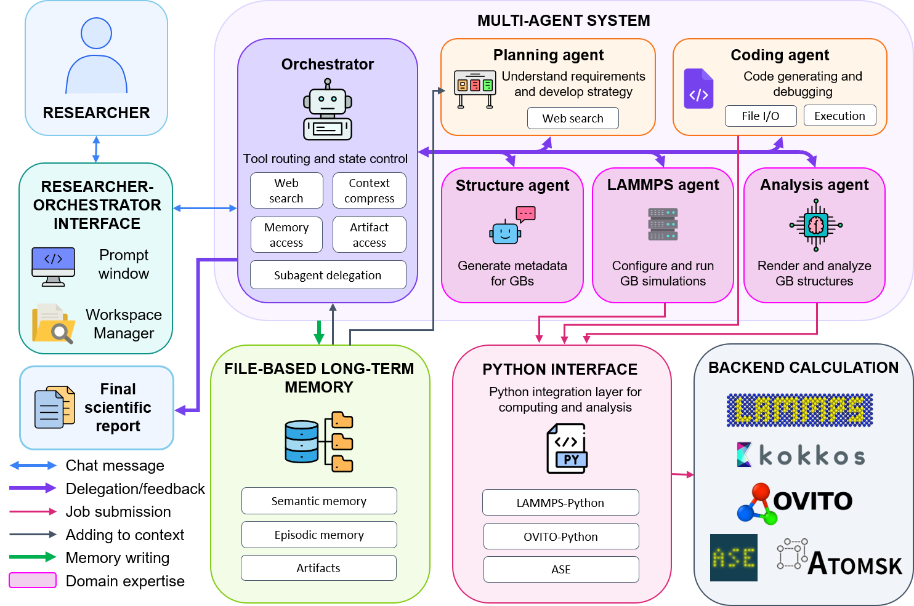

# Architecture and design

[Documentation](README.md) · [中文](zh/architecture.md) · [Getting started](getting-started.md)

GBClaw is designed for investigations that change as evidence accumulates. A researcher may begin by comparing many grain boundaries, notice an unusual response, and then ask a different question about one structure. The system must support both consistent calculations across cases and targeted follow-up work without losing the connection to earlier results.

This guide explains the choices behind that design. It draws on the framework manuscript's architecture, memory, and discussion sections; the linked technical guides describe the current implementation. See [references](references.md) for the manuscript and the separate study of grain boundary physics.

## One coordinator, focused specialists

The orchestrator is the researcher's point of contact. It interprets the request, chooses the next task, and brings the results back into the discussion. Five specialists handle planning, crystallography, LAMMPS simulations, analysis, and custom coding.

*Manuscript Figure 1. The current implementation stores research records in SQLite and scientific outputs in files. Some illustrated integrations require optional software; planning-agent web search remains an extension point.*

This division keeps each agent's task and context manageable. A structure worker needs the crystal geometry and relevant previous structures; it does not need every plot or conversation in the project. A delegated task therefore includes a clear objective, known constraints, and references to relevant evidence. The worker can retrieve more detail when needed and returns its status, findings, and output references.

Scientific dependencies still determine execution order. Analysis of a relaxed structure needs that structure first. Independent boundary cases can run concurrently, subject to the configured compute budget. Delegation expresses who should do the work; resource admission determines when the work can run. See [agent runtime](agent-runtime.md) and [resource configuration](configuration.md).

## Plans preserve the researcher's decisions

A plan makes assumptions and dependencies visible before a large investigation starts. The planning agent produces a draft; the researcher reviews or changes it, and explicit approval activates it. A bounded task can proceed without creating a new plan.

After execution begins, the plan records progress and references the resulting runs. A change of direction creates a reviewable revision while retaining completed work. For example, a screening study can lead to an additional NEB investigation of one boundary without replacing the history of the original screening.

The planning agent defines an approach, scientific tools produce results, and the researcher evaluates whether those results answer the scientific question. These responsibilities remain separate throughout the investigation. The [planning lifecycle](agent-runtime.md#delegate-tools) documents approval, revision, and execution details.

## Standard tools and custom code have different jobs

Routine calculations need stable inputs, checks, and output records so that cases can be compared. Structure, LAMMPS, and Analysis tools provide those repeatable workflows. The model chooses and interprets tool calls; the tool owns the numerical procedure and its saved outputs.

The coding agent handles small tasks that fall outside those workflows, such as reading an unusual data format or producing a custom comparison. It receives selected artifacts, works in an isolated temporary workspace, and publishes selected outputs after validation. Its Python environment is chosen from a host-controlled registry. The optional `ase` environment provides a route to Atomic Simulation Environment once the environment and package are installed.

This gives researchers room to explore without redefining routine methods for every run. When a custom script becomes a repeated part of the research workflow, a maintainer can turn it into a domain tool after checking its physical assumptions, inputs, and numerical behavior. See [scientific tools](tools.md), [coding tasks](coding-agent.md), and [extension interfaces](extension-guide.md).

## Memory keeps orientation separate from evidence

The current conversation, a project overview, and a trajectory serve different purposes. Keeping them separate lets the agent resume a discussion with a small context while retaining access to detailed evidence.

| Information | Role | Example |
| --- | --- | --- |
| Domain knowledge | Explain methods and tool rules. | Which inputs are required for a valid NEB setup. |
| Project summary | Orient the agent to the investigation. | Current objective, important findings, unresolved questions, and retrieval pointers. |
| Recent conversation and Session summary | Maintain continuity within the discussion. | The researcher has asked to compare two completed cases next. |
| Persistent research records | Make claims and calculations searchable. | A run's inputs and status, a sourced conclusion, and references to its outputs. |
| Artifacts | Preserve the detailed scientific material. | Atomic structures, numerical arrays, trajectories, logs, and scripts. |

A **run** records a workflow execution, a **fact** records a sourced claim or piece of project state, and an **artifact** is an indexed output file. Stable identifiers connect them. For example, a conclusion about a stress drop should lead back to the shear run, analysis data, and relevant atomic structures.

The project summary is intentionally incomplete. Compression should retain active objectives, important findings, and open questions while reducing detail about older completed work. Earlier summary versions remain in SQLite, and the current summary supplies archive IDs and short topic previews so an agent can recover omitted context. Detailed calculations and artifacts remain available independently of any summary. See [project memory](project-memory.md).

Full chat and tool traces are retained separately for human review. Selected claims extracted from a completed user–assistant exchange keep their conversation origin; they do not become calculation results merely because they are stored. Tool results, conversation-derived claims, agent reports, and workflow state remain distinguishable during retrieval and summarization.

## A project lasts longer than one conversation context

The project is the durable research workspace. Its records and artifacts survive a browser reload, a service restart, or a long break. A thread identifies a conversation's execution state within that project; elapsed time alone does not require a new thread. Returning to the same project can resume its existing thread.

Two summaries support this continuity. The **Project summary** describes durable research state across the project. The **Session summary** helps the model follow the current thread without replaying its full history. Neither replaces the underlying research records. This separation also explains the code boundary: `agents/middleware/` manages conversation context, while `project_memory/snapshot/` prepares read-only memory snapshots and `project_memory/summary/` manages Project summaries.

The HTTP API behind the Web UI and the terminal CLI run each turn through the same pipeline in `interfaces/turn.py`: it takes execution ownership, prepares the session, streams the orchestrator, records the exchange, and starts post-completion memory work. Only parsing input and rendering events differ between the two transports. Project occupancy controls which frontend owns an active conversation and prevents overlapping requests from changing the same execution state. After the visible answer finishes, the backend may still be persisting the turn and updating memory. The UI marks this as finalization and becomes ready after execution ownership is released. See [API and UI](api-and-ui.md).

## Following an investigation through the layers

Suppose a researcher wants to understand why one nickel grain boundary resists sliding more strongly than related boundaries.

| Stage | System responsibility | Researcher's role |
| --- | --- | --- |
| Define the question | Recover relevant previous work and identify missing inputs. | Set the scientific objective and constraints. |
| Plan | Propose comparable cases, calculations, dependencies, and checks. | Review assumptions, choose settings, and approve the plan. |
| Execute | Construct structures and run calculations; record inputs, status, and artifacts. | Inspect intermediate results when needed. |
| Analyze | Compare responses and connect numerical changes to structures. | Assess whether the evidence supports the proposed interpretation. |
| Refine | Draft targeted follow-up work, such as an NEB calculation. | Decide which explanation to investigate next. |
| Continue later | Recover the compact project overview, then retrieve exact records as needed. | Return to the same project and ask the next question. |

The important property is that a follow-up question can recover the inputs and evidence behind a result. Successful execution and correct source links support review; physical correctness still depends on the model, parameters, numerical checks, and scientific interpretation.

## Boundaries that make extension easier

| Component | Owns | Why the boundary matters |
| --- | --- | --- |
| `core/` | Paths, settings, model construction, execution sessions and subprocess supervision, and the chat stream event schema. | Shared foundations import no domain or agent code. |
| `extensions/` | The registry of domain declarations: workers, tools, memory records, capabilities, and host hooks. | New domains declare their records and policies through a shared interface. |
| `project_workspace/` | Project metadata, chat archives, safe project-file access, execution ownership, and runtime persistence. | Durable workspace ownership is separate from a model's context. |
| `project_memory/` | Memory publication, artifact manifests, search, retrieval, snapshots, and Project summaries. | Research records follow one set of storage and provenance rules for every domain. |
| `planning/` | Plan drafts, approval, revisions, step progress, and planning mode. | Researcher decisions are stored and enforced independently of any agent. |
| `agents/` | Coordination, worker invocation, conversation context, and event reporting. | A new scientific method can reuse the same execution lifecycle. |
| Domain packages under `domains/` | Scientific algorithms, inputs, checks, domain-specific output interpretation, and each domain's worker, delegate, prompts, and declarations. | Changing the science does not require changing generic storage. |
| `interfaces/` and `web/` | The shared turn pipeline, HTTP API, CLI, frontend ownership, and the research interface. | Web presentation can evolve while using the same project and execution contracts. |

Packages are layered in this dependency order, with `core` at the bottom: `core` ← `extensions` ← `project_workspace` ← `project_memory` ← `planning` ← `agents` ← `domains` ← `interfaces`. The agent layer reaches domain workers, delegate factories, tool sets, and routing guidance through registry hook strings (`"module:attr"`), so adding a domain does not change agent code. Domains also declare the orchestrator's own domain tools (`orchestrator_tools`) and the planner's rules for their steps (`planning_guidance`).

To add a small custom computation, start with the [coding environment registry](coding-agent.md#runtime-environment-registry). To add a recurring scientific tool or a new specialist, use the [memory extension guide](extension-guide.md). The [source map](src-code-map.md) shows where each responsibility lives.
